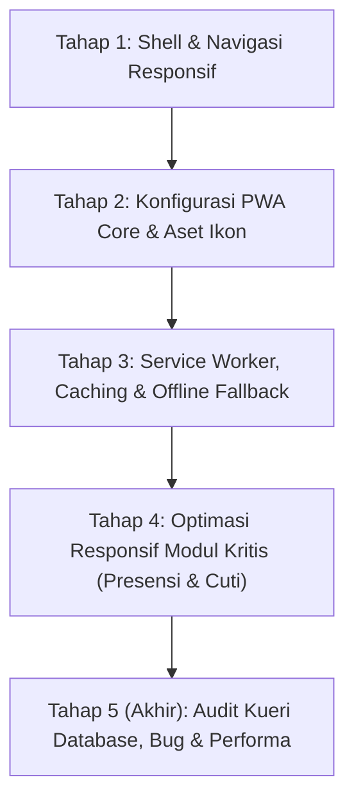

# Master Plan: Implementasi PWA & Web Responsif HRIS PSPK

> **Status:** Siap Dieksekusi (Tahap demi Tahap: 1 Respon = 1 Tahapan)  
> **Target Aplikasi:** `apps/hris` (Portal HRIS PSPK)  
> **Framework:** Next.js 16 (App Router), React 19, Tailwind CSS v4, Prisma ORM  

---

## 1. Latar Belakang & Sasaran

Sistem HRIS PSPK saat ini memiliki fondasi fungsional yang kuat dan lengkap. Namun, antarmuka shell utama (`shell-container.tsx`) masih mengunci padding kiri (`pl-[264px]`) untuk sidebar desktop, sehingga di layar smartphone (< 768px) area konten utama menjadi sangat sempit (~110px).

Mayoritas pegawai PSPK berinteraksi dengan HRIS untuk kegiatan harian mendesak seperti:
1. **Presensi Harian (Clock In / Clock Out)** di pagi dan sore hari langsung dari ponsel.
2. **Pengajuan Izin / Cuti Sakit Mendadak** saat tidak berada di depan laptop.
3. **Persetujuan (Approval) Cuti oleh Manajer** secara cepat melalui smartphone.
4. **Pengecekan Slip Gaji** bulanan.

Dengan menjadikan HRIS sebagai **Progressive Web App (PWA)** dan **Responsif Penuh**, pegawai dapat menambahkan HRIS ke layar utama smartphone (*Add to Home Screen*) tanpa bar URL browser, merasakan navigasi secepat aplikasi native, dan tetap mendapatkan pengalaman informatif saat koneksi internet offline.

---

## 2. Arsitektur Solusi & Aturan Kerja

* **Prinsip 1 Tahapan = 1 Respon:** Setiap tahapan dieksekusi secara terpisah dan tuntas agar perubahan kode terukur, mudah direview, dan tidak menimbulkan regresi.
* **Tidak Merusak Desktop UX:** Layout desktop (sidebar lebar/collapse) tetap dipertahankan 100%. Mode responsif menggunakan pendekatan adaptif berbasis breakpoint Tailwind (`md:` / 768px).
* **Zero Cost Infra:** PWA dibangun secara native menggunakan standar Web App Manifest dan Service Worker bawaan browser modern, sepenuhnya berjalan di container Docker VPS tanpa ketergantungan cloud berbayar.
* **Brand Guidelines PSPK:** Tetap mematuhi warna resmi (#102E50 Navy, #F2AF3E Gold, #A8281C Maroon) dan tipografi (Lora untuk heading, Rubik untuk body).



---

## 3. Rincian 5 Tahapan Pengembangan

### Tahap 1: Pondasi Shell & Navigasi Responsif Mobile ✅ (Selesai)
**Status:** **SELESAI (100% Terverifikasi)**  
**Tujuan:** Membebaskan layout dari batasan desktop sehingga konten dapat terbuka penuh dan rapi di semua ukuran layar ponsel/tablet.

* **Pekerjaan Teknis yang Telah Diterapkan:**
  1. **`shell-container.tsx` (`apps/hris/src/components/shell/`):**
     * Padding kiri kontainer utama menjadi adaptif: `pl-0 md:pl-20 md:pl-[264px]`.
     * State `mobileNavOpen` dengan penangan memoized `useCallback`.
     * Safe bottom padding `pb-20 md:pb-6` agar konten tidak tertutup bilah navigasi bawah ponsel.
  2. **`app-topbar.tsx` (`apps/hris/src/components/shell/`):**
     * Offset bilah atas menjadi `left-0 md:left-20 md:left-[264px]`.
     * Tombol **Hamburger Menu** (`<Menu className="w-5 h-5" />`) pada mobile (`md:hidden`).
     * Breadcrumb teks dirapikan dengan text truncation agar judul halaman tidak terpotong.
     * Mode Pratinjau Super Admin disembunyikan di layar mobile (`hidden md:flex`) untuk mencegah tabrakan UI.
  3. **`app-sidebar.tsx` (`apps/hris/src/components/shell/`):**
     * Kemampuan **Mobile Slide-Over Drawer**: meluncur halus dari kiri (`-translate-x-full md:translate-x-0` saat tertutup, `translate-x-0` saat terbuka) dengan backdrop gelap (`bg-slate-950/60 backdrop-blur-xs`).
     * Tombol tutup `X` khusus mobile.
     * Auto-close drawer saat rute berpindah atau saat menekan tombol Escape.
     * Tombol collapse desktop disembunyikan di perangkat mobile (`hidden md:inline-flex`).
  4. **Komponen Baru `mobile-bottom-nav.tsx` (`apps/hris/src/components/shell/`):**
     * Navigasi bawah tetap (*fixed bottom-0*) khusus mobile (`md:hidden`) dengan 4 akses cepat ramah jangkauan jempol:
       * 🏠 **Beranda** (`/dashboard`)
       * ⏱️ **Presensi** (`/absensi`)
       * 📅 **Cuti** (`/cuti`) dengan badge approval tertunda
       * 👤 **Profil** (`/profil`)
* **Kriteria Keberhasilan (DoD):**
  * ✅ `pnpm typecheck` lolos (9/9 paket).
  * ✅ `pnpm lint` lolos (0 error, 0 warning).
  * ✅ `pnpm test` lolos (42 test suites, 284 test passed).

---

### Tahap 2: Konfigurasi PWA Core & Aset Ikon ✅ (Selesai)
**Status:** **SELESAI (100% Terverifikasi)**  
**Tujuan:** Mengaktifkan kapabilitas instalasi PWA di Android dan iOS dengan identitas brand PSPK yang lengkap.

* **Pekerjaan Teknis yang Telah Diterapkan:**
  1. **`apps/hris/src/app/manifest.ts`:**
     * Implementasi `MetadataRoute.Manifest` resmi Next.js App Router:
       * `name`: "PSPK HRIS - Sistem Kepegawaian"
       * `short_name`: "PSPK HRIS"
       * `display`: "standalone" (menghilangkan bilah navigasi browser)
       * `theme_color`: "#102e50"
       * `background_color`: "#f8f9ff"
       * `orientation`: "portrait"
       * Pendaftaran ikon 192x192, 512x512, dan maskable icon.
  2. **Metadata Viewport & Apple Meta di `layout.tsx` (`apps/hris/src/app/`):**
     * Ekspor konstanta `viewport`:
       ```ts
       export const viewport: Viewport = {
         themeColor: "#102e50",
         width: "device-width",
         initialScale: 1,
         maximumScale: 1,
         userScalable: false,
         viewportFit: "cover",
       };
       ```
     * Tag meta Apple Web App: `capable: true`, `statusBarStyle: "default"`, `title: "HRIS PSPK"`.
  3. **Penyediaan Aset Ikon PWA Standar di `apps/hris/public/icons/`:**
     * Dibuat dari sumber resmi `apps/hris/public/images/logo_pspk_vertikal.jpg`:
       * `icon-192.png` (192 × 192 px)
       * `icon-512.png` (512 × 512 px)
       * `icon-maskable.png` (512 × 512 px)
       * `apple-touch-icon.png` (180 × 180 px)
* **Kriteria Keberhasilan (DoD):**
  * ✅ `pnpm typecheck` lolos (9/9 paket).
  * ✅ `pnpm lint` lolos (0 error, 0 warning).
  * ✅ `pnpm test` lolos (42 test suites, 284 test passed).
  * ✅ `pnpm --filter @pspk/hris build` lolos (rute `/manifest.webmanifest` berhasil digenerate statis).

---

### Tahap 3: Service Worker, Caching Strategy & Offline Fallback
**Tujuan:** Memberikan performa pemuatan instan (*instant load*) dan ketahanan aplikasi saat internet lambat atau terputus.

* **Pekerjaan Teknis:**
  1. **Service Worker (`apps/hris/public/sw.js`):**
     * **Strategi Network-First:** Digunakan untuk semua kueri API, Server Actions, dan navigasi data kepegawaian (presensi, cuti, saldo) agar data selalu akurat dan tidak pernah menampilkan informasi kadaluwarsa (*stale*).
     * **Strategi Cache-First / Stale-While-Revalidate:** Digunakan untuk aset statis (web fonts Lora & Rubik, logo resmi PSPK, ikon Lucide, stylesheet, dan bundle JavaScript).
  2. **Registrasi Service Worker (`pwa-register.tsx`):**
     * Komponen client-side ringan yang meregistrasikan `sw.js` saat aplikasi berjalan di browser pengguna.
  3. **Halaman Offline Fallback (`apps/hris/src/app/offline/page.tsx`):**
     * Tampilan ramah dan berwibawa bergaya brand PSPK saat pegawai membuka halaman tanpa koneksi internet sama sekali, dilengkapi indikator status koneksi dan tombol "Coba Lagi".
  4. **Komponen Banner Pasang Aplikasi (*Install Prompt*):**
     * Banner elegan yang dapat ditutup (*dismissible*) untuk mengajak pegawai menginstal HRIS ke layar utama ponsel mereka.
* **Kriteria Keberhasilan (DoD):**
  * Uji simulasi *Offline* di tab Network browser tetap menampilkan halaman fallback elegan tanpa layar error browser bawaan ("No Internet").

---

### Tahap 4: Optimasi Responsif Modul Kritis
**Tujuan:** Memastikan modul yang paling sering dibuka di ponsel memiliki pengalaman pengguna yang cepat, mudah disentuh, dan bebas kendala.

* **Pekerjaan Teknis:**
  1. **Modul Presensi (`today-attendance-card.tsx`):**
     * Optimasi ukuran tombol Clock In / Clock Out dengan target sentuhan jempol minimal 48 × 48 px.
     * Penataan dropdown pemilih zona waktu (WIB, WITA, WIT) agar tidak terpotong di layar ponsel sempit.
  2. **Modul Pengajuan Cuti (`leave-request-form.tsx`):**
     * Penyesuaian formulir tanggal dan unggah lampiran agar nyaman diisi dengan keyboard virtual ponsel.
  3. **Tabel Data Karyawan, Cuti & Timesheet:**
     * Penyempurnaan `overflow-x-auto` dengan indikator scroll horizontal visual atau penyajian berbasis kartu (*Card View*) di layar ponsel (< 640px).
  4. **Pratinjau Slip Gaji (`payslip-printable-modal.tsx`):**
     * Optimasi tampilan dokumen slip gaji agar pas di layar ponsel sebelum dicetak/diunduh.
* **Kriteria Keberhasilan (DoD):**
  * Seluruh alur utama staf (absen datang, absen pulang, cek saldo cuti, ajukan cuti) dapat diselesaikan 100% menggunakan satu tangan di smartphone.

---

### Tahap 5 (Tahap Akhir): Audit Kueri Database, Pengecekan Bug & Pengecekan Performa
**Tujuan:** Menjamin keandalan data, ketiadaan kebocoran memori/kueri lambat, dan kecepatan sistem secara menyeluruh sebelum dinyatakan siap rilis.

* **Pekerjaan Teknis:**
  1. **Pengecekan Kueri Database (Prisma Query Audit):**
     * Audit 15 berkas kueri di `apps/hris/src/server/queries/`:
       * Cek kueri berulang (N+1 query) pada relasi `employee`, `attendance`, `leaveRequest`, dan `payrollPeriod`.
       * Verifikasi penggunaan klausul `select` yang hemat kolom untuk mencegah data sensitif yang tidak perlu terkirim ke client.
       * Verifikasi keberadaan indeks database yang diperlukan di `packages/db/prisma/schema/hris.prisma` untuk mempercepat pencarian data absensi dan cuti bulanan.
  2. **Pengecekan Bug & Edge Cases:**
     * Verifikasi penanganan *safe area insets* pada perangkat iPhone bertakik (notch/Dynamic Island).
     * Verifikasi pencegahan masalah auto-zoom iOS saat fokus ke field input (memastikan ukuran font input minimal 16px).
     * Pengujian kondisi batas saat transisi online-ke-offline di tengah mutasi form.
  3. **Pengecekan Performa & Skala:**
     * Pengukuran metrik Core Web Vitals (Largest Contentful Paint < 2.5s, Cumulative Layout Shift < 0.1).
     * Audit ukuran aset bundle JavaScript.
     * Eksekusi seluruh suite verifikasi otomatis monorepo:
       * `pnpm typecheck`
       * `pnpm lint`
       * `pnpm test`
       * `pnpm build`
* **Kriteria Keberhasilan (DoD):**
  * Kueri database teroptimasi tanpa N+1.
  * Seluruh tes unit/integrasi lolos 100%.
  * Skor Lighthouse mobile untuk performa dan PWA mencapai standar terbaik.

---

## 4. Alur Persetujuan & Eksekusi

Sesuai aturan **1 tahapan per 1 respon**, alur kerja kita adalah:
1. **Respon Berikutnya:** Mengeksekusi secara tuntas **Tahap 1 (Pondasi Shell & Navigasi Responsif Mobile)**, melakukan verifikasi teknis, dan melapor ke Anda.
2. Anda meninjau hasil Tahap 1, lalu memberikan instruksi lanjut ke Tahap 2, dan seterusnya hingga Tahap 5.

