# Spesifikasi Implementasi: Detail Karyawan 360° & Ekspor Profil (PDF & ZIP Package)

> **Rute Utama:** `/karyawan/[id]` · **Aplikasi:** `apps/hris`  
> **Status:** Final Specification & Technical Blueprint  
> **Dasar Pengembangan:** Masukan HR PSPK + Evaluasi Skema Prisma (`hris`, `core`, `sysmgmt`) + Integrasi Formulir Wizard Karyawan

---

## 0. Keputusan Arsitektur & Aturan Bisnis yang Ditetapkan

| # | Aspek | Keputusan Final |
|---|---|---|
| **1** | **Mekanisme Ekspor & Penanganan Berkas (Solusi ZIP)** | **Bila opsi "Sertakan Berkas Dokumen & Foto" dicentang**, sistem **TIDAK menggabungkan dokumen ke dalam satu PDF raksasa** (menghindari memory overload, server timeout, dan kerusakan format file non-PDF). Sebagai gantinya, sistem otomatis mengemas dan mengunduh berkas dalam format **ZIP Archive** (`[NIP]_[Nama]_Profil_Lengkap.zip`) yang berisi:<br>1. `[NIP]_Profil_Karyawan.pdf` (Dokumen PDF profil bersih & rapi)<br>2. Folder `Dokumen_Lampiran/` berisi seluruh file dokumen asli karyawan (KTP, NPWP, Ijazah, CV, SK Kontrak, dll.) dengan penamaan yang terstruktur. Jika opsi ini tidak dicentang, sistem langsung mengunduh file tunggal `[NIP]_Profil_Karyawan.pdf`. |
| **2** | **Koneksi End-to-End UI/UX ke Database** | **Tidak ada data mock/dummy yang terputus.** Seluruh tab (Ringkasan, Biodata, Absensi, Kontrak, Mutasi, Dokumen, Aset, Akun) langsung terhubung dengan query Prisma riil (`Employee`, `Attendance`, `LeaveBalance`, `LeaveRequest`, `TimesheetSubmission`, `EmployeeAddress`, `EmployeeFamilyMember`, `EmployeeEducation`, `EmployeeTraining`, `EmployeeWorkExperience`, `EmployeeDocument`, `AssetAssignment`). |
| **3** | **Aset Visual & Fallback Avatar di PDF** | • **Header Logo:** [`apps/hris/public/images/logo_pspk_horizontal.png`](file:///Users/imadearisdanuarta/Documents/KERJAAN/system_hris-system_management/hris_system_management/apps/hris/public/images/logo_pspk_horizontal.png)<br>• **Watermark Latar Belakang:** [`apps/hris/public/images/icon_pspk.jpg`](file:///Users/imadearisdanuarta/Documents/KERJAAN/system_hris-system_management/hris_system_management/apps/hris/public/images/icon_pspk.jpg) (opasitas 6–8% diagonal)<br>• **Foto Profil Karyawan:**<br>  - Jika ada `photoKey` terunggah: Ambil dari storage provider.<br>  - Jika belum ada foto & gender **FEMALE**: Gunakan [`apps/hris/public/images/Avatar_Wanita.jpg`](file:///Users/imadearisdanuarta/Documents/KERJAAN/system_hris-system_management/hris_system_management/apps/hris/public/images/Avatar_Wanita.jpg)<br>  - Jika belum ada foto & gender **MALE** (atau default): Gunakan [`apps/hris/public/images/Avatar_Pria.jpg`](file:///Users/imadearisdanuarta/Documents/KERJAAN/system_hris-system_management/hris_system_management/apps/hris/public/images/Avatar_Pria.jpg) |
| **4** | **Tab Absensi Dinamis** | Tab Absensi menampilkan log kehadiran bulanan dinamis dengan pemilih bulan/tahun. Untuk ekspor, HR/Manager dapat menentukan rentang tanggal bebas (*custom date range*). |
| **5** | **Matriks Otorisasi Ekspor (RBAC)** | • **Super Admin & Admin HR:** Akses ekspor seluruh karyawan + opsi buka data sensitif/gaji (wajib konfirmasi audit).<br>• **Manager:** Hanya dapat mengekspor karyawan di tim/divisinya (bawahan langsung atau divisi yang sama), **TIDAK memiliki akses ke data sensitif/kompensasi** (opsi terkunci disabled).<br>• **Staff & Admin IT:** Tidak memiliki izin ekspor profil. |
| **6** | **Seluruh Data Wizard Tampil di Profil & PDF** | Seluruh data yang diisi pada 4 langkah wizard pendaftaran (data pribadi, keluarga, pendidikan, pelatihan, pengalaman kerja, penempatan, kontrak, kompensasi, data sensitif) tampil lengkap di profil dan diekspor ke PDF tanpa ada field yang hilang. |

---

## 1. Struktur Halaman Detail Karyawan (`/karyawan/[id]`)

Halaman dirancang dengan arsitektur **360° Employee View**, terbagi menjadi **Hero Profile Card** di bagian atas dan **Sistem Tab Navigasi** di bawahnya.

```
┌────────────────────────────────────────────────────────────────────────────────────────┐
│ [← Kembali]                                                                            │
│                                                                                        │
│ [============================= HERO PROFILE CARD ===================================] │
│ Foto/Avatar | Nama Lengkap & Gelar ("Panggilan")           [Export Profil] [Ubah Profil]│
│ Jabatan • Divisi                                                                       │
│ Badges: NIP | Status | PTKP | Tipe Ikatan | Role Akun        [Nonaktifkan / Aktifkan]  │
│ Kontak Cepat: Email Kantor | No HP/WA | Atasan Langsung | Tanggal Bergabung            │
└────────────────────────────────────────────────────────────────────────────────────────┘
│                                                                                        │
│ [Ringkasan] [Biodata] [Absensi] [Kontrak] [Jabatan & Tim] [Dokumen] [Aset] [🔒Sensitif]│
└────────────────────────────────────────────────────────────────────────────────────────┘
```

### 1.1 Hero Profile Card (Header Profil)
- **Avatar & Fallback:** Menggunakan komponen `EmployeeAvatar`. Jika `photoKey` kosong, tampilkan avatar default sesuai gender (`Avatar_Pria.jpg` / `Avatar_Wanita.jpg`) atau inisial nama.
- **Identitas Inti:** Nama lengkap, gelar, nama panggilan (*nickname*), jabatan aktif (`currentPosition.title`), dan departemen (`currentDepartment.name`).
- **Badges Status:** NIP, Status Kepegawaian (`ACTIVE`, `PROBATION`, `ON_LEAVE`, `RESIGNED`, `TERMINATED`), Status PTKP (`TK/0`–`K/3`), Tipe Kontrak Master, dan badge Peran Sistem Akun Login.
- **Tombol Aksi Utama:**
  - **"Export Profil" (Baru):** Memicu `ExportProfileModal` (hanya muncul untuk HR/Admin dan Manager yang berhak).
  - **"Ubah Profil":** Menuju ke wizard ubah data `/karyawan/[id]/ubah` (khusus HR/Admin).
  - **"Nonaktifkan / Aktifkan Kembali":** Tombol perubahan status siklus hidup karyawan dengan modal konfirmasi dan audit trail.
- **Quick Contact Strip:** Email kantor (`mailto:`), nomor telepon/WhatsApp (`tel:`), atasan langsung (link profil), dan tanggal bergabung.

---

### 1.2 Sistem Tab Navigasi (Role-Protected)

| Tab | Nama Tab | Hak Akses | Ringkasan Konten |
|---|---|---|---|
| **1** | **Ringkasan** *(Default)* | Semua | Dashboard eksekutif profil karyawan: KPI masa kerja, kehadiran bulan ini, sisa cuti tahunan, kelengkapan berkas, aset aktif, serta bar persentase **Kelengkapan Profil (%)**. |
| **2** | **Biodata & Riwayat** | Semua | Data pribadi lengkap, kontak darurat, tabel alamat KTP & Domisili, tabel susunan keluarga, tabel riwayat pendidikan, tabel pelatihan & sertifikasi, serta tabel riwayat pengalaman kerja. |
| **3** | **Absensi & Cuti** | Semua | Pemilih bulan/tahun, kartu statistik bulanan (Hadir, Terlambat, Izin, Alpha, WFH, Libur, % Kehadiran, Jam Timesheet), grid kalender absensi bulanan, tabel log harian, dan tabel saldo cuti tahunan. |
| **4** | **Kontrak & Upah** | Semua (Gaji khusus HR) | Ringkasan struktur kompensasi & estimasi BPJS/Pajak (khusus HR/Admin), tabel riwayat kontrak kerja (PKWT/PKWTT/Freelance), serta tombol unduh & unggah berkas kontrak PDF fisik bertanda tangan. |
| **5** | **Jabatan & Mutasi** | Semua | Hierarki atasan & bawahan langsung, garis waktu vertikal (*career timeline*) riwayat promosi/rotasi, serta modal mutasi cepat (`TransferPositionModal`). |
| **6** | **Dokumen Digital** | Semua | Checklist dokumen wajib (KTP, NPWP, BPJS, Ijazah, CV, SK Kontrak), filter kategori berkas, fitur upload drag-and-drop, pratinjau modal (*preview*), unduh, dan hapus. |
| **7** | **Aset & Fasilitas** | Semua *(Modular)* | Tergantung feature flag `asset_assignment`: daftar perangkat laptop/inventaris yang sedang dipinjamkan dan riwayat pengembalian aset. |
| **8** | **Data Sensitif 🔒** | HR / Super Admin | NIK, NPWP, dan No. Rekening Bank terlindungi enkripsi AES-256-GCM dengan tombol *"Buka Data"* berbasis audit modal, serta kartu detail perpajakan PP 58/2023 (Kategori TER & Metode Pajak). |
| **9** | **Akun & Akses 🔑** | HR / IT / Super Admin | Status akun Better Auth, tombol *"Buat Akun"* dengan generate temporary password, dan modal pengaturan peran sistem (RBAC). |

---

## 2. Rincian Desain & Komponen per Tab

### 2.1 Tab 1: Ringkasan (Overview 360° — Default Landing)
1. **Kartu Skor KPI Utama (4 Grid):**
   - **Masa Kerja:** Dihitung otomatis dari `joinDate` s.d. hari ini (format: `X Tahun Y Bulan`).
   - **Tingkat Kehadiran Bulan Ini:** Persentase hadir + tepat waktu dari total hari kerja bulan berjalan (dari data tabel `Attendance`).
   - **Sisa Cuti Tahunan:** Total sisa kuota cuti tahunan aktif (`quotaDays - usedDays` dari `LeaveBalance`).
   - **Aset & Fasilitas:** Jumlah unit perangkat kantor yang sedang dibawa staf (dari `AssetAssignment` aktif).
2. **Indikator Kelengkapan Profil Karyawan (%):**
   - Bar progress persentase yang dihitung dinamis dari kelengkapan 12 komponen vital:
     *(1) Foto Profil, (2) Alamat KTP, (3) Alamat Domisili, (4) Kontak Darurat, (5) Data Keluarga, (6) Riwayat Pendidikan, (7) Pengalaman Kerja, (8) Dokumen KTP, (9) Dokumen NPWP, (10) Dokumen Ijazah, (11) Dokumen CV, (12) No. Rekening Bank.*
   - Menampilkan daftar checklist ringkas bagian mana yang belum dilengkapi agar HR atau staf dapat melengkapinya.
3. **Kartu Penempatan & Status Kontrak Aktif:**
   - Ringkasan divisi, posisi, atasan langsung, nomor kontrak aktif, dan sisa masa berlaku kontrak kerja (*countdown* hari jika mendekati jatuh tempo).

---

### 2.2 Tab 2: Biodata & Riwayat Terpadu
Menampilkan data terstruktur dengan pemisahan tabel yang rapi:
1. **Identitas Diri & Informasi Pribadi:**
   - Nama lengkap, nama panggilan, jenis kelamin, tempat & tanggal lahir (beserta usia saat ini), agama, kewarganegaraan, golongan darah, status pernikahan, dan nama ibu kandung.
2. **Kontak & Telepon:**
   - Email kantor resmi, email pribadi, nomor telepon seluler / WhatsApp, telepon rumah (*landline*), serta kartu informasi kontak darurat (nama, nomor telepon, dan status hubungan keluarga).
3. **Tabel Alamat Lengkap (KTP & Domisili):**
   - Menampilkan tabel dari relasi `EmployeeAddress` (kolom: Tipe Alamat, Alamat Jalan, RT/RW, Kelurahan, Kecamatan, Kota/Kabupaten, Provinsi, Kode Pos).
   - Memiliki *fallback* otomatis ke kolom `employee.address` jika data lama belum termigrasi ke tabel relasi alamat.
4. **Tabel Susunan Anggota Keluarga (`EmployeeFamilyMember`):**
   - Kolom: Nama Lengkap, Hubungan (`FATHER`, `MOTHER`, `SPOUSE`, `CHILD`, dll.), Tanggal Lahir, No. Handphone, Status Tanggungan BPJS/Pajak (Ya/Tidak), Catatan.
5. **Tabel Riwayat Pendidikan Formal (`EmployeeEducation`):**
   - Kolom: Jenjang (`SD`, `SMP`, `SMA_SMK`, `D3`, `D4`, `S1`, `S2`, `S3`), Nama Institusi / Universitas, Jurusan / Program Studi, Tahun Kelulusan, Nilai Akhir / IPK.
   - Kolom lampiran: tautan pratinjau ijazah jika terunggah di dokumen.
6. **Tabel Riwayat Pelatihan & Sertifikasi (`EmployeeTraining`):**
   - Kolom: Nama Pelatihan / Workshop, Penyelenggara, Jenis Keikutsertaan, Rentang Tanggal, Durasi Jam/Hari, Lokasi.
   - Kolom sertifikat: tautan pratinjau sertifikat jika terhubung ke `EmployeeDocument`.
7. **Tabel Pengalaman Kerja Terdahulu (`EmployeeWorkExperience`):**
   - Kolom: Nama Perusahaan, Jabatan Terakhir, Periode Kerja (Tanggal Mulai s.d. Tanggal Selesai; jika `endDate == null` tampilkan badge hijau **"Sekarang / Aktif"**), Alasan Berhenti, Deskripsi Singkat Tanggung Jawab.

---

### 2.3 Tab 3: Absensi & Cuti (Attendance & Leave Hub)
Terhubung langsung ke database tanpa mock data:
1. **Bilah Kontrol Periode:** Pemilih Bulan & Tahun dinamis dengan tombol *Previous* / *Next* bulan (default: bulan & tahun berjalan).
2. **Ringkasan Kehadiran Bulanan (Cards):**
   - Total Hari Kerja Efektif (dihitung dari `WorkScheduleSetting.workingDays` dikurangi `Holiday` nasional).
   - Jumlah Hari Hadir Tepat Waktu (`PRESENT`).
   - Jumlah Keterlambatan (`LATE`).
   - Jumlah Bekerja dari Rumah (`WFH`).
   - Jumlah Izin / Cuti (`LEAVE`).
   - Jumlah Ketidakhadiran / Alpha (`ABSENT`).
   - Tingkat Persentase Kehadiran (%) bulan tersebut.
   - Total Jam Kerja Khusus Karyawan Paruh Waktu / Freelance (dihitung dari `TimesheetSubmission.totalHours` yang telah disetujui).
3. **Visual Grid Kalender Bulanan:** Kalender mini 7-kolom (Senin–Minggu) dengan pewarnaan kode status harian:
   - Hijau: Hadir Tepat Waktu.
   - Kuning/Amber: Terlambat.
   - Biru: WFH.
   - Ungu: Cuti / Izin Resmi.
   - Merah: Alpha / Libur Nasional.
4. **Tabel Rincian Log Kehadiran Harian:**
   - Kolom: Hari & Tanggal, Jam Masuk (*Check-in*), Jam Pulang (*Check-out*), Durasi Kerja, Status Kehadiran, Metode/Sumber Catatan (`WEB`, `MANUAL_HR`, `IMPORT`), Catatan Pegawai, Catatan Koreksi HR.
5. **Tabel Pengajuan Cuti & Saldo Cuti Tahunan:**
   - Riwayat izin/cuti yang diambil pada bulan tersebut (Jenis Cuti, Tanggal, Durasi Hari, Status Approval, Keterangan).
   - Tabel Saldo Cuti Karyawan Tahun Berjalan (`LeaveBalance` per `LeaveType`): Kuota Awal, Kuota Terpakai, Sisa Hari Cuti Aktif.

---

### 2.4 Tab 4 s.d. Tab 9 (Lanjutan)
- **Tab 4 (Kontrak & Upah):** Menampilkan rincian paket gaji & tunjangan bulanan aktif, perhitungan iuran BPJS Kesehatan (1%) & Ketenagakerjaan (2%), status TER PP 58/2023, serta tabel riwayat kontrak lengkap dengan tombol upload berkas SK fisik PDF bertanda tangan ([`EmployeeContractsTable`](file:///Users/imadearisdanuarta/Documents/KERJAAN/system_hris-system_management/hris_system_management/apps/hris/src/components/karyawan/employee-contracts-table.tsx)).
- **Tab 5 (Jabatan & Tim):** Hierarki atasan & bawahan langsung, garis waktu mutasi/promosi, serta modal mutasi jabatan ([`CareerHistoryCard`](file:///Users/imadearisdanuarta/Documents/KERJAAN/system_hris-system_management/hris_system_management/apps/hris/src/components/karyawan/career-history-card.tsx) & [`TransferPositionModal`](file:///Users/imadearisdanuarta/Documents/KERJAAN/system_hris-system_management/hris_system_management/apps/hris/src/components/karyawan/transfer-position-modal.tsx)).
- **Tab 6 (Dokumen Digital):** Checklist kelengkapan 7 dokumen wajib pendaftaran, filter kategori berkas, upload dokumen baru, preview berkas PDF/gambar di modal, download, dan hapus berkas ([`EmployeeDocumentsCard`](file:///Users/imadearisdanuarta/Documents/KERJAAN/system_hris-system_management/hris_system_management/apps/hris/src/components/karyawan/employee-documents-card.tsx)).
- **Tab 7 (Aset & Fasilitas):** Inventaris laptop/perangkat kantor aktif dan riwayat pengembalian ([`EmployeeAssetsCard`](file:///Users/imadearisdanuarta/Documents/KERJAAN/system_hris-system_management/hris_system_management/apps/hris/src/components/karyawan/employee-assets-card.tsx)).
- **Tab 8 (Data Sensitif 🔒):** NIK, NPWP, Rekening Bank terenkripsi AES-256-GCM dengan tombol unmasking audit ([`SensitiveFieldView`](file:///Users/imadearisdanuarta/Documents/KERJAAN/system_hris-system_management/hris_system_management/apps/hris/src/components/karyawan/sensitive-field-view.tsx)).
- **Tab 9 (Akun & Akses 🔑):** Status akun sistem Better Auth & konfigurasi peran RBAC ([`EmployeeAccountRoleCard`](file:///Users/imadearisdanuarta/Documents/KERJAAN/system_hris-system_management/hris_system_management/apps/hris/src/components/karyawan/employee-account-role-card.tsx)).

---

## 3. Spesifikasi Lengkap Ekspor Profil (PDF & ZIP Package)

### 3.1 Antarmuka Modal "Export Profil" (`ExportProfileModal`)

```
┌────────────────────────────────────────────────────────────────────────┐
│ Ekspor Profil Lengkap Karyawan                             [✕ Tutup]  │
│ Pegawai: I Made Aris Danuarta (NIP: PSPK-2024-001)                     │
├────────────────────────────────────────────────────────────────────────┤
│ Bagian Profil yang Disertakan (Centang yang dibutuhkan):               │
│ [✓] 1. Data Diri & Informasi Kontak                                    │
│ [✓] 2. Alamat Lengkap (KTP & Domisili)                                 │
│ [✓] 3. Susunan Keluarga & Tanggungan                                   │
│ [✓] 4. Riwayat Pendidikan, Pelatihan & Pengalaman Kerja                │
│ [✓] 5. Penempatan, Divisi & Riwayat Jabatan                            │
│ [✓] 6. Riwayat Kontrak Kerja                                           │
│ [✓] 7. Rekap Absensi & Cuti                                            │
│        Rentang Tanggal: [ 01/01/2026 ] s.d. [ 31/01/2026 ]            │
│ [✓] 8. Daftar Berkas Dokumen & Status Kelengkapan                      │
│ [✓] 9. Aset Inventaris Kantor yang Dibawa                              │
│                                                                        │
│ Opsi Data Terlindungi (Memerlukan Hak Akses Khusus):                   │
│ [ ] Sertakan Data Sensitif (NIK, NPWP, No. Rekening Bank) 🔒           │
│ [ ] Sertakan Struktur Kompensasi & Gaji Pokok (Payroll) 🔒             │
│ *(Terkunci otomatis jika login sebagai Manager)*                       │
│                                                                        │
│ Pengemasan Berkas & Dokumen Asli:                                      │
│ [ ] Unduh sebagai Paket Arsip Lengkap (.ZIP)                          │
│     Menyertakan file PDF profil + seluruh berkas dokumen asli (KTP,   │
│     Ijazah, Kontrak, Foto, dll.) dalam folder terorganisir.            │
├────────────────────────────────────────────────────────────────────────┤
│ Format Unduhan: [ PDF Dokumen Profil ] atau [ Paket Arsip .ZIP ]       │
│                                           [ Batal ]  [ 📥 Unduh Data ] │
└────────────────────────────────────────────────────────────────────────┘
```

- **Mekanisme Validasi Privasi:** Jika opsi sensitif atau kompensasi dicentang, sistem memunculkan konfirmasi audit sebelum proses pengunduhan dimulai.
- **Pengecekan di Server (Server-Side Enforcement):** Server Route Handler memverifikasi ulang token sesi dan peran pengguna. Jika pengguna ber-role Manager mencoba mengirimkan request dengan flag sensitif aktif, server **wajib mengabaikan atau menolak** parameter tersebut.

---

### 3.2 Desain Layout PDF Halaman per Halaman

Dokumen PDF dibuat dengan ukuran **A4**, orientasi **Portrait**, margin standar **15mm**, menggunakan palet warna resmi PSPK (*Navy* `#102E50`, *Gold* `#F2AF3E`, *Slate* `#475569`), tipografi **Lora** untuk heading dan **Rubik** untuk isi teks.

#### Elemen Tetap Setiap Halaman (Header, Footer & Watermark)
- **Header:** Logo horizontal PSPK ([`apps/hris/public/images/logo_pspk_horizontal.png`](file:///Users/imadearisdanuarta/Documents/KERJAAN/system_hris-system_management/hris_system_management/apps/hris/public/images/logo_pspk_horizontal.png)) di pojok kiri atas, judul dokumen di pojok kanan atas (*"DOKUMEN REKAM DATA KEPEGAWAIAN"*), dibatasi garis aksen Navy & Gold.
- **Watermark:** Logo lingkaran/ikon PSPK ([`apps/hris/public/images/icon_pspk.jpg`](file:///Users/imadearisdanuarta/Documents/KERJAAN/system_hris-system_management/hris_system_management/apps/hris/public/images/icon_pspk.jpg)) di tengah halaman dengan opasitas transparan **6%**. Jika pegawai berstatus keluar (`TERMINATED`/`RESIGNED`), tambahkan teks diagonal merah transparan: **"STATUS: NONAKTIF / TERMINATED"**.
- **Footer Keamanan & Audit Forensik:**
  - Kiri: *"DOKUMEN RAHASIA & TERBATAS – HANYA UNTUK KEPERLUAN INTERNAL PSPK"*
  - Tengah: ID Rekam: `DOC-[UUID-PENDEK]` • Dicetak Oleh: `[Nama Akun Pengunduh]` • Waktu: `DD/MM/YYYY HH:mm WIB`
  - Kanan: Nomor Halaman `"Halaman X dari Y"`

---

#### Struktur Halaman Dokumen PDF

| Urutan | Bagian Dokumen | Format Tata Letak di PDF |
|---|---|---|
| **Halaman 1** | **Sampul Profil & Ringkasan Eksekutif** | • **Kop Resmi & Foto Profil (Ukuran 3x4):** Menampilkan foto asli karyawan dari storage. Jika tidak ada, otomatis menggunakan [`Avatar_Wanita.jpg`](file:///Users/imadearisdanuarta/Documents/KERJAAN/system_hris-system_management/hris_system_management/apps/hris/public/images/Avatar_Wanita.jpg) (wanita) atau [`Avatar_Pria.jpg`](file:///Users/imadearisdanuarta/Documents/KERJAAN/system_hris-system_management/hris_system_management/apps/hris/public/images/Avatar_Pria.jpg) (pria).<br>• **Tabel Ringkasan Identitas Pegawai:** Nama Lengkap, Gelar, NIP, Jabatan, Departemen/Divisi, Status Kepegawaian, Tipe Ikatan Kerja, Tanggal Bergabung, Masa Kerja.<br>• **Tabel Kontak & Darurat:** Email Kantor, Email Pribadi, No. HP/WA, Telepon Rumah, Nama Kontak Darurat, No. HP Darurat, Hubungan Keluarga. |
| **Halaman 2** | **Alamat & Susunan Keluarga** | • **Tabel Alamat (2 Kolom / Baris):** Rincian Alamat KTP dan Alamat Domisili lengkap (Jalan, Kelurahan, Kecamatan, Kota, Provinsi, Kode Pos).<br>• **Tabel Anggota Keluarga:** Tabel berisi daftar keluarga (Nama, Status Hubungan, Tanggal Lahir, Usia, No. HP, Status Tanggungan). |
| **Halaman 3** | **Pendidikan, Pelatihan & Pengalaman Kerja** | • **Tabel Riwayat Pendidikan:** Jenjang, Nama Sekolah / Universitas, Program Studi, Tahun Lulus, Nilai/IPK.<br>• **Tabel Riwayat Pelatihan:** Nama Pelatihan, Penyelenggara, Periode, Durasi Jam.<br>• **Tabel Pengalaman Kerja:** Nama Perusahaan, Jabatan Terakhir, Periode (s.d. "Sekarang" jika aktif), Alasan Berhenti. |
| **Halaman 4** | **Penempatan, Kontrak & Kompensasi** | • **Tabel Penempatan & Karir:** Lokasi Kerja, Entitas Hukum / TKU, Atasan Langsung, Tanggal Akhir Probation, Riwayat Mutasi Jabatan.<br>• **Tabel Kontrak Kerja:** Tipe Ikatan, Nomor Kontrak (hasil parse `[Nomor: ...]`), Tanggal Mulai s.d. Berakhir, Status Kontrak.<br>• **Tabel Kompensasi & Pajak (Jika Diizinkan):** Gaji Pokok / Upah Per Jam, Rincian Komponen Tunjangan Bulanan, Status PTKP & Kategori TER, Metode Pemotongan Pajak PPh 21.<br>• **Tabel Data Sensitif (Jika Diizinkan):** NIK KTP, NPWP, Paspor/KITAS, No. BPJS Kesehatan, No. BPJS Ketenagakerjaan, Rekening Bank & Atas Nama. *(Jika tidak diizinkan, nilai dicetak "— DILINDUNGI —")*. |
| **Halaman 5** | **Rekapitulasi Absensi & Saldo Cuti** | • **Kotak Ringkasan Kehadiran:** Menampilkan statistik dalam rentang tanggal yang dipilih (Hari Kerja, Hadir, Telat, WFH, Cuti, Alpha, % Kehadiran).<br>• **Tabel Riwayat Log Kehadiran:** Tanggal, Hari, Jam Masuk, Jam Pulang, Durasi, Status, Keterangan.<br>• **Tabel Saldo Cuti Tahunan:** Jenis Cuti, Kuota Hak, Terpakai, Sisa Kuota. |
| **Halaman 6** | **Daftar Dokumen, Aset & Pengesahan** | • **Tabel Inventaris Dokumen Digital:** Kategori Dokumen, Nama Berkas, Status Kelengkapan (Terunggah / Belum Terunggah), Tanggal Unggah.<br>• **Tabel Aset Inventaris Kantor:** Tag Aset, Nama Perangkat, Brand/Tipe, Nomor Seri, Tanggal Serah Terima, Kondisi.<br>• **Kolom Tanda Tangan Resmi (2 Kolom):**<br>  1. Dibuat Oleh: *HR Administrator* (Nama, Jabatan, Tanggal)<br>  2. Mengetahui / Disetujui: *Atasan Langsung / Direktur SDM* (Nama, Jabatan, Tanggal). |

---

### 3.3 Format Pengemasan Berkas ZIP (`.zip`)

Bila opsi **"Unduh sebagai Paket Arsip Lengkap (.ZIP)"** dipilih:
1. Server membuat PDF utama: `[NIP]_[Nama_Karyawan]_Profil.pdf`.
2. Server membuat arsip ZIP di memori / temporary stream menggunakan library `archiver`.
3. Struktur folder di dalam berkas ZIP:

```
[NIP]_[Nama_Karyawan]_Profil_Lengkap.zip
├── [NIP]_[Nama_Karyawan]_Profil.pdf
└── Dokumen_Lampiran/
    ├── 01_Foto_Profil.[jpg/png]
    ├── 02_KTP_[Nama].[pdf/jpg]
    ├── 03_NPWP_[Nama].[pdf/jpg]
    ├── 04_Kartu_Keluarga_[Nama].[pdf]
    ├── 05_Ijazah_[Jenjang]_[Nama].[pdf]
    ├── 06_CV_Resume_[Nama].[pdf]
    ├── 07_Kontrak_Kerja_[NoKontrak].[pdf]
    ├── 08_Surat_Pengalaman_[Perusahaan].[pdf]
    └── [Kategori]_[NamaDokumen].[ext]
```

- Seluruh berkas lampiran diambil dari storage provider lokal (`/storage/documents/...`) berdasarkan `fileKey` tabel `EmployeeDocument`.
- Nama berkas di-rename rapi dan mudah dibaca (menghilangkan UUID acak file storage).
- Respons dikirim via Route Handler Next.js dengan header:
  `Content-Type: application/zip` dan `Content-Disposition: attachment; filename="[NIP]_[Nama]_Profil_Lengkap.zip"`.

---

## 4. Pemetaan Lengkap Database (Prisma Schema ke Fitur)

Seluruh komponen halaman detail dan ekspor PDF terhubung langsung ke model database riil:

```mermaid
erDiagram
    Employee ||--o| User : "akun login Better Auth (userId)"
    Employee ||--|| Department : "currentDepartmentId"
    Employee ||--|| Position : "currentPositionId"
    Employee ||--o| Employee : "managerId (atasan)"
    Employee ||--o{ Employee : "directReports (bawahan)"
    Employee ||--o{ EmployeeAddress : "alamat KTP & Domisili"
    Employee ||--o{ EmployeeFamilyMember : "susunan keluarga"
    Employee ||--o{ EmployeeEducation : "riwayat pendidikan"
    Employee ||--o{ EmployeeTraining : "riwayat pelatihan"
    Employee ||--o{ EmployeeWorkExperience : "pengalaman kerja"
    Employee ||--o{ EmploymentContract : "kontrak kerja aktif & arsip"
    Employee ||--o{ EmploymentHistory : "riwayat mutasi & promosi"
    Employee ||--o{ EmployeeDocument : "arsip berkas digital"
    Employee ||--o{ EmployeeSalaryComponent : "tunjangan tetap"
    Employee ||--o{ Attendance : "log presensi harian"
    Employee ||--o{ LeaveBalance : "saldo kuota cuti tahunan"
    Employee ||--o{ LeaveRequest : "permohonan cuti"
    Employee ||--o{ TimesheetSubmission : "jam kerja lembur / hourly"
    Employee ||--o{ AssetAssignment : "peminjaman inventaris laptop"
    User ||--o{ UserRole : "peran pengguna"
    UserRole }o--|| Role : "definisi RBAC"
```



### Query Database yang Disediakan / Diperluas di `apps/hris`:
1. `getEmployeeById(id: string)`:
   Mengambil data inti `Employee` beserta relasi `currentDepartment`, `currentPosition`, `manager`, `directReports`, `contracts`, `histories`, `user`, `documents`, `workLocation`, `legalEntity`, `addresses`, `familyMembers`, `educations`, `trainings`, `workExperiences`, dan `salaryComponents`.
2. `getEmployeeMonthlyAttendance(employeeId: string, year: number, month: number)` (Baru):
   Mengambil log `Attendance` untuk rentang bulan berjalan, data `LeaveRequest` yang disetujui pada bulan tersebut, hari libur nasional (`Holiday`), serta total jam kerja disetujui dari `TimesheetSubmission`.
3. `getEmployeeLeaveBalances(employeeId: string, year: number)` (Baru):
   Mengambil daftar `LeaveBalance` beserta `LeaveType` aktif karyawan untuk menghitung sisa saldo cuti.
4. `getEmployeeExportFullData(employeeId: string, attendanceStartDate?: Date, attendanceEndDate?: Date)` (Baru):
   Mengambil data lengkap teragregasi untuk kebutuhan rendering PDF profil karyawan dan pengemasan ZIP lampiran.

---

## 5. Rencana Penerapan Bertahap (Action Plan)

Pekerjaan dibagi menjadi **3 Fase Terukur**:

### FASE 1: Komponen UI Halaman Detail & Integrasi Data Riil
- [ ] **Tab Biodata:** Render komponen tabel terpisah untuk `addresses` (KTP & domisili), `familyMembers`, `educations`, `trainings`, dan `workExperiences`. Tampilkan seluruh field pribadi (`motherName`, `landlinePhone`, `bloodType`, `religion`, `citizenship`, `emergencyContactRelation`).
- [ ] **Tab Ringkasan (Baru & Default):** Buat komponen dashboard 360° yang menghitung masa kerja, sisa cuti, total aset, total dokumen, serta progress bar kelengkapan data profil karyawan (%).
- [ ] **Tab Absensi (Terhubung ke Query):** Buat query data absensi bulanan dan komponen UI pemilih bulan/tahun, kartu statistik bulanan, grid kalender absensi, tabel log presensi harian, dan tabel saldo cuti.
- [ ] **Tab Dokumen:** Tambahkan checklist status kelengkapan 7 dokumen wajib pendaftaran.
- [ ] **Tombol & Modal Export:** Pasang tombol *"Export Profil"* di Hero Card dan buat modal interaktif `ExportProfileModal` dengan opsi rentang tanggal, pilihan data sensitif (disabled untuk Manager), dan opsi unduhan ZIP.

### FASE 2: Backend Ekspor PDF & Generator Arsip ZIP
- [ ] **Mesin PDF:** Buat template dokumen PDF resmi menggunakan `@react-pdf/renderer` dengan palet warna PSPK, font Lora & Rubik, logo horizontal, watermark ikon transparan, dan penanganan foto profil fallback (`Avatar_Wanita.jpg` / `Avatar_Pria.jpg`).
- [ ] **Pengemasan ZIP:** Integrasikan library `archiver` untuk mengompres PDF profil dan seluruh berkas fisik dari storage provider ke dalam format `.zip`.
- [ ] **Route Handler Ekspor:** Buat endpoint API `/api/karyawan/[id]/export` (mendukung `format=pdf` dan `format=zip`).
- [ ] **Audit Trail & RBAC:** Terapkan validasi otorisasi di server (hanya Super Admin, HR, dan Manager tim terkait). Catat log audit `EXPORT_PROFILE` dan `VIEW_SENSITIVE` pada `core.audit_logs`.

### FASE 3: Pengujian Menyeluruh (Verification & Hardening)
- [ ] Jalankan verifikasi kualitas: `pnpm typecheck`, `pnpm lint`, dan `pnpm build`.
- [ ] Uji responsivitas tampilan di mobile dan desktop.
- [ ] Uji ekspor PDF dengan berbagai kondisi data (data lengkap vs data kosong/minimal, pegawai aktif vs nonaktif).
- [ ] Uji performa unduhan ZIP saat karyawan memiliki banyak dokumen.
